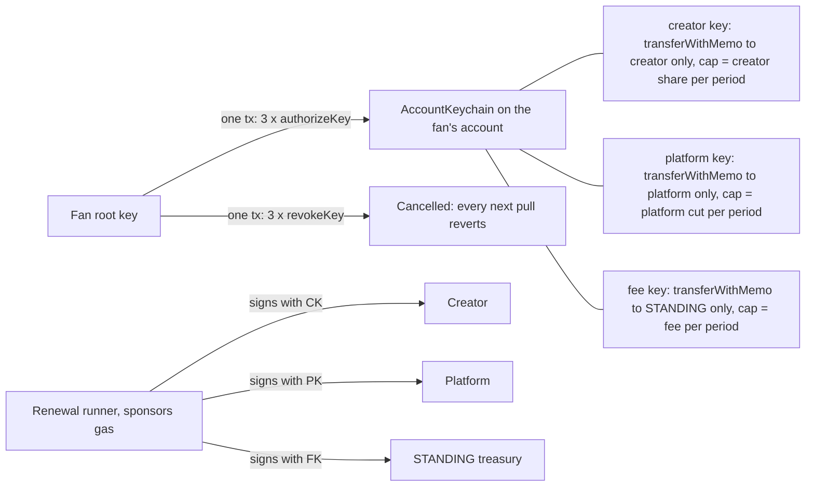

# STANDING

**A platform takes its cut of a creator's membership income on Tempo without ever holding the creator's money. One fan signature installs three access keys on the fan's own account: one pays only the creator, one pays only the platform, one pays only the STANDING fee, each capped per period by the chain.**

- API and renewal runner: https://standing-tempo.fly.dev/api/health
- Network: Tempo Moderato (chain 42431), pathUSD
- Live plans: `GET https://standing-tempo.fly.dev/api/plans`

## The problem

A marketplace that sells creators' memberships has one way to bill on Tempo today: `tempo.subscription()` in mppx pays a single recipient. So the platform receives every renewal and pays creators out.

> "For a marketplace with recurring payments that means being the recipient and paying creators out, i.e. holding money that isn't ours."
> nofluffdev, [wevm/mppx discussion #905](https://github.com/wevm/mppx/discussions/905), 2026-09-17

> "A simple example: a $10 membership pays $8 to the creator and $2 to the platform each period."
> EfeDurmaz16, [wevm/mppx#920](https://github.com/wevm/mppx/issues/920), 2026-09-27. The open implementation proposed for that issue splits in the SDK, and its author notes "The key still permits 10/0 or an omitted share".

Holding customer funds, even briefly, is what marketplace payout guides name as the money transmission trigger ([Whop](https://whop.com/blog/marketplace-payouts/), [ComplyOne](https://complyone.tech/blog/when-does-a-marketplace-need-a-money-transmitter-license)). Tempo itself pitches access keys and periodic limits for exactly this kind of billing ([@tempo](https://x.com/tempo/status/2080073778693063123)).

## How it works



1. **Checkout.** The fan signs one Tempo transaction with three `authorizeKey` calls on AccountKeychain (`0xaAAA…0000`). Each key gets one `SelectorRule`: only `transferWithMemo` (`0x95777d59`) on pathUSD, only to one recipient, and a periodic spending limit equal to that party's share.
2. **Renewal.** Each period the runner signs one pull per key from the fan's account, creator first, and pays the gas as fee payer, so the fan only ever spends the membership price. Every pull carries a 32-byte memo: plan id, role, period end.
3. **Cancel.** The fan signs one transaction with three `revokeKey` calls. The next pull reverts `KeyAlreadyRevoked`.

The runner holds only those three keys. A key that can pay one address, at most one share per period, is safe to run anywhere: whoever holds it can only do what the fan already agreed to.

## What the chain refuses

Measured on Moderato in [`evidence/e2e-2026-10-11T16-53-20-969Z.jsonl`](evidence/e2e-2026-10-11T16-53-20-969Z.jsonl) (19 of 19 checks):

| Attempt | Result |
|---|---|
| Platform pulls its cut a second time in the same period | `SpendingLimitExceeded` |
| Platform key pays the creator's address | `CallNotAllowed` |
| Fee key pays the platform's address | `CallNotAllowed` |
| Creator pulls 0.01 more than its share | `SpendingLimitExceeded` |
| Creator key pulls from an account that never subscribed | `KeyNotFound` |
| Any pull after the fan cancels | `KeyAlreadyRevoked` |

The same refusals run live on demand: `POST /api/attack` with `kind` = `overcut`, `redirect`, `creator-redirect` or `outsider` makes the runner try to cheat with the real keys and returns the chain's revert name.

Control from the mechanism test: one key scoped to *both* recipients, the shape the #920 implementation relies on, let the platform take all 10.00 of a 10.00 membership ([`0xd7391cf8…0076`](https://explore.testnet.tempo.xyz/tx/0xd7391cf8f998c695bd3317850932d0ee1cda170f6a918daed4ee6b26bcde0076)). One key per party is what makes the split hold.

## Proof on Moderato

From the e2e run (10.00 membership, 20% platform cut, 1% fee):

- Checkout, secp256k1 root: one tx, three keys, [`0x5cac82e0…6d32`](https://explore.testnet.tempo.xyz/tx/0x5cac82e0856736d97b0a0cfd48d8fcc4318b8ad01e6db92ee0462c8ab7ed6d32)
- Checkout, WebCrypto P256 root (a browser key that never leaves the device): [`0x3bb5856a…11d1`](https://explore.testnet.tempo.xyz/tx/0x3bb5856ae3a54926314b2105be66e7613814dd96832e36f078412212c12e11d1)
- Two periods for fan A, one for fan B: creator +24.00, platform +5.70, STANDING +0.30, fan A -20.00, fan B -10.00, exact to 6 decimals
- The fans' gas-token balance did not move during pulls: the runner paid every fee
- Cancel, three revokes in one tx: [`0xb240b8d5…20d5`](https://explore.testnet.tempo.xyz/tx/0xb240b8d50a9cd0d41b2f617d9dd11083cdd53b890a4e54457b9d7b8f80a620d5), 47,764 gas

The deployed runner renews on its own: `npx tsx scripts/verify-live.ts` reads every plan from the API and every pull from chain logs, and passes only when a member has at least two complete periods paid by the runner's tick.

## Business model

STANDING earns through the same mechanism it sells. The third key in every checkout pays the STANDING treasury a fee per renewal (default 1% of the price), taken out of the platform's cut, so the fan's price and the creator's share stay exactly as advertised. The chain caps that fee the same way it caps the platform: STANDING cannot take more than its line says.

## Architecture

- `src/core/`: the whole protocol surface, shared by server, browser and scripts. `calls.ts` builds the checkout and cancel calls, `membership.ts` reads `getKey`, `getRemainingLimitWithPeriod` and `getAllowedCalls` and checks each key's scope against the plan, `pull.ts` signs a sponsored renewal pull and names the protocol's refusal, `ledger.ts` rebuilds renewals from `TransferWithMemo` logs, `memo.ts` encodes plan, role and period into the memo.
- `server/`: plans API and renewal runner (Node, fly.io). Finds members from `KeyAuthorized` logs on the plan's creator key, pulls whatever the chain still shows as unpaid this period, pays the creator first, retries RPC burst limits with backoff.
- `scripts/e2e.ts`: the live run behind every number above. `scripts/verify-live.ts`: the deployed-runner check. `scripts/seed.ts`: demo plans and members through the public API.

## Run it

```bash
npm install
npx vitest run                      # unit tests: split, memo, scope of every key, refusal parsing
npx tsx scripts/e2e.ts              # live Moderato run, fresh accounts from the faucet, writes evidence/
npx tsx scripts/verify-live.ts      # checks the deployed runner against chain logs

# local API: SPONSOR_KEY (gas payer) and TREASURY (fee recipient) come from your environment
DATA_DIR=./data-local npx tsx server/index.ts
```

## Built during the hackathon

The mechanism test (`split-pull-keys`, one tx authorizing two recipient-bound keys) ran on Oct 11, 2026. Every line of product code in this repo was written on Oct 11 and 12, 2026, inside the Crypto World's Fair submission window. Dependencies: viem (Tempo actions), React, Vite.

## License

MIT
